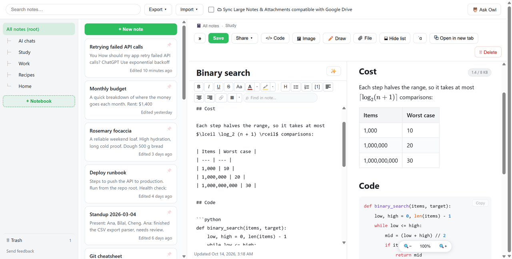
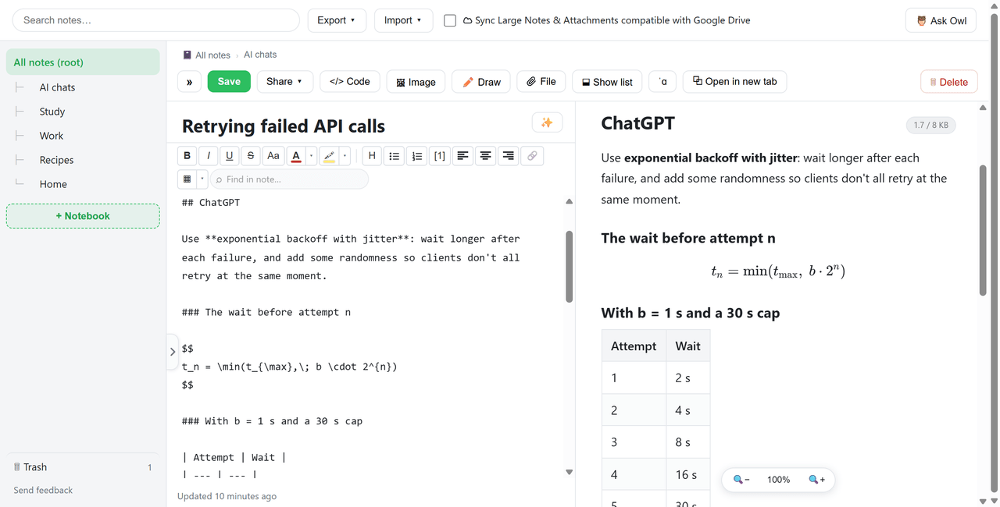
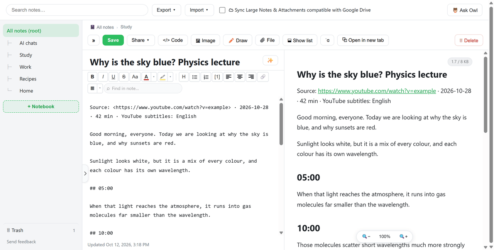
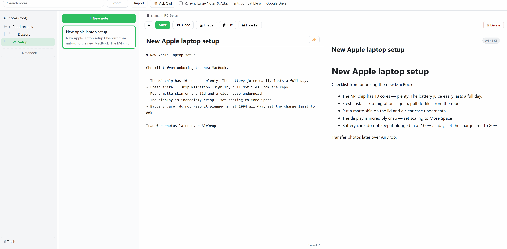

# 🦉 OWL-Note

**English** · [繁體中文](README.zh-HK.md)

### Save AI chats, transcribe videos and keep Markdown notes, free, in your browser.

Your notes are encrypted bookmarks, synced by the Chrome or Edge account you already use. No OWL-Note account, server or subscription.

#### [➜ Add to Chrome / Edge — free](https://chromewebstore.google.com/detail/hjkbpgkmiaeojfhkpnhmokgjipenhcfl)

---

### ✨ Features

**Save AI chats as real Markdown**

Right‑click a chat → **OWL‑Note** → **Rebuild LLM chat to OWL‑Note**

Turns a ChatGPT, Claude, Gemini or Google AI Studio conversation into an editable note, not a screenshot:

- **Each message labelled** with who said it
- **Headings, paragraphs, lists, links and tables**
- **Code blocks** that keep their language
- **Math** as LaTeX, rendered with KaTeX
- **Supported images** as attachments, and a link back to the source

It runs on your device, with no API key and no tokens. On other sites it rebuilds the page's readable content, without speaker labels. Sites change their pages, so if a chat comes out wrong, please [report it](https://github.com/hinagate/owl-note/issues/new).

**Turn a playing video into a transcript**

Right‑click a page → **OWL‑Note** → **Live Transcription save to OWL‑Note** (Chrome 139+)

- On YouTube, a video with subtitles is saved at once as a timestamped note, in the creator's own words.
- Otherwise Chrome's on‑device speech recognition transcribes it live, with a caption overlay you can drag.
- The audio is never stored or uploaded.

**Ask Owl: find notes by what they mean**

Ask in plain words and get the passages that answer, with citations that jump to the note.

- **Keyword search** works straight away. **Semantic search** is optional, after a one‑time download of about 130 MB. Ask *"How many cores does my Apple have?"* and it picks the laptop note over the apple crisp recipe.
- **With your browser's on‑device AI** (Gemini Nano in Chrome, Phi in Edge) it writes the answer too. The browser downloads the model once, about 2–4 GB, if you choose to enable it. Without it, you get the matching excerpts.
- **Summarize** a note, **Tidy** its Markdown without rewriting your words, or get a suggested title.
- Works in Chinese, Japanese and Korean.

**Capture from any page**

- **Capture entire page to OWL‑Note** scrolls and stitches the whole page into one long image, opened ready to mark up.
- **Save selection to OWL‑Note** keeps the selected text as Markdown, with its headings, lists, links, code blocks and tables.

All of it is processed on your device.

**A full Markdown notebook**

- Live preview and automatic saving
- Syntax‑highlighted code, KaTeX math, and Mermaid diagrams
- Nested notebooks, pinning, and multi‑select
- Search from the top bar or the browser address bar, and find text inside a note
- Photos and file attachments, a sketchpad, and marking up photos
- **Phonetic Assistance** shows pronunciation above the words: IPA for English, hiragana for Japanese, Jyutping for Cantonese. Select a word to hear it, at normal or slow speed
- Trash you can restore from

---

### 🔒 Privacy and Sync

- **Notes are stored as bookmarks**, encrypted with AES‑256‑GCM so other extensions can't read them. Titles stay plain text, so they come up in the address bar.
- **They sync through your Chrome or Edge account**, under that provider's terms. The key travels the same way, so this protects notes from other software, not from your browser vendor. Set a sync passphrase if that matters to you.
- **No OWL‑Note account, backend, telemetry or ads.** Capture, transcription, search and AI all run on your device.
- **A bookmark holds about 8 KB per note.** Larger notes, photos and files stay on that device unless you turn on the optional Google Drive sync, which stores them in your own Drive. A transcript passes 8 KB after roughly 15–20 minutes.
- **Back up your encryption key.** Without it, your notes can't be opened after a reinstall. Drive sync does this for you, or use **Export → Recovery key**.
- **Hearing a word** uses a voice on your computer. If it has none for that language, OWL‑Note asks before using your browser's online voice, which sends what you selected to Google or Microsoft.
- Install OWL‑Note on each device to read your notes there.

Read the full [privacy policy](PRIVACY.md).

---

### 📦 Installation, Import, Export

**Install**

- From the [Chrome Web Store](https://chromewebstore.google.com/detail/hjkbpgkmiaeojfhkpnhmokgjipenhcfl), for Chrome, Edge and other Chromium browsers.
- From source: run `npm install` and `npm run build`, then load the `dist/` folder as an unpacked extension. Google Drive sync stays off in your own builds unless you add your own OAuth credentials.

**Import**

- Evernote ENEX
- Word DOCX
- Markdown and Markdown ZIP
- JSON backups
- .owl‑note packages

**Export**

- Every note as Markdown in a ZIP
- A note as PDF, or as a portable .owl‑note package

---

### 📖 The Story

I built **OWL‑Note** from a simple belief: **people have the right to take notes for free.**

Writing down thoughts is natural; it shouldn’t be over‑engineered or locked behind subscriptions.

So I set one constraint: **use only infrastructure people already have** and make the simplest, most private note app possible. That constraint shaped every design choice:

- Notes live as **browser bookmarks** — private, portable, and **synced automatically** by the Chrome or Edge account you already use.
- When a note exceeds bookmark limits, an **optional Google Drive** layer stores the overflow.
- AI features run **entirely on the browser’s on‑device model** — no servers, no API keys, no per‑question billing.

Every constraint made OWL‑Note lighter and more personal. It isn’t a cloud platform — it’s a notebook you actually own.

---

### 🤝 Feedback

- Found a problem? [Open an issue](https://github.com/hinagate/owl-note/issues/new).
- If OWL‑Note is useful to you, a ⭐ here or a [review on the Chrome Web Store](https://chromewebstore.google.com/detail/hjkbpgkmiaeojfhkpnhmokgjipenhcfl) helps others find it.

---

### 🆓 License

**GPL‑3.0**

Source code: **[https://github.com/hinagate/owl-note](https://github.com/hinagate/owl-note)**

#### Mermaid

Diagrams are drawn by [Mermaid](https://github.com/mermaid-js/mermaid) (MIT), shipped
unmodified under `mermaid/` in the extension. The licence notices for Mermaid and the code
it bundles are in `mermaid/THIRD_PARTY_NOTICES.txt`.

#### Pronunciation data

The phonetic reading tables are generated at build time from third‑party dictionaries and
shipped as data files. They are not part of the program's source code, and each keeps its
own licence:

| Table | Source | Licence |
| --- | --- | --- |
| `ipa-en.tsv.gz` — English IPA | [CMU Pronouncing Dictionary](https://github.com/cmusphinx/cmudict) (Carnegie Mellon University) | ISC |
| `kana-ja.tsv.gz` — Japanese kanji readings | [yomi-dict](https://github.com/marmooo/yomi-dict) | Apache‑2.0 |
| `jyutping-yue.tsv.gz` — Cantonese Jyutping | [rime-cantonese](https://github.com/rime/rime-cantonese) (CanCLID), vendored in [`vendor/rime-cantonese`](vendor/rime-cantonese) | CC BY 4.0 |

`jyutping-yue.tsv.gz` is adapted from rime-cantonese's character and word dictionaries and
is distributed under [CC BY 4.0](https://creativecommons.org/licenses/by/4.0/).
