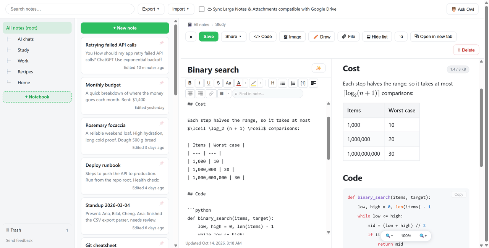
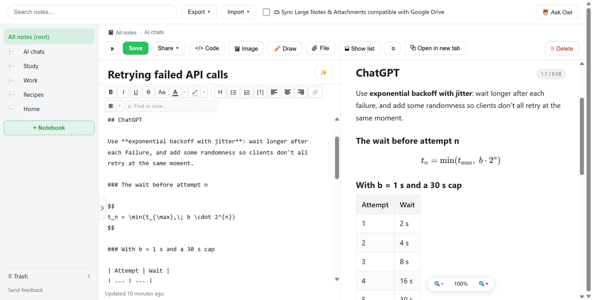
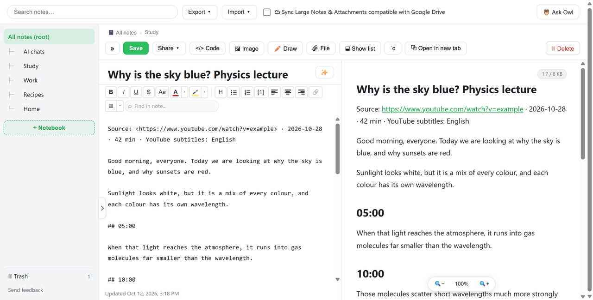
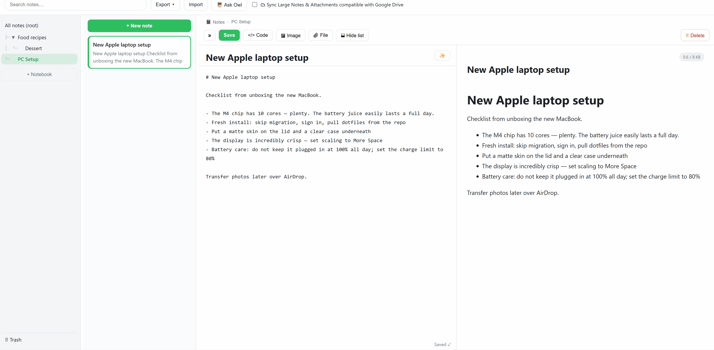

# 🦉 OWL-Note

[English](README.md) · **繁體中文**

### 在瀏覽器裡免費儲存 AI 對話、把影片變成逐字稿、寫 Markdown 筆記。

筆記會加密成書籤，透過你現有的 Chrome 或 Edge 帳號同步。不需要 OWL-Note 帳號，沒有伺服器，也沒有訂閱費。

#### [➜ 免費加入 Chrome / Edge](https://chromewebstore.google.com/detail/hjkbpgkmiaeojfhkpnhmokgjipenhcfl)

> 目前介面為英文，所以下面的選單名稱也保留英文。筆記內容、搜尋和 Ask Owl 都支援中文。

---

### ✨ 功能

**把 AI 對話存成真正的 Markdown**

在對話頁按右鍵 → **OWL-Note** → **Rebuild LLM chat to OWL-Note**

把 ChatGPT、Claude、Gemini 或 Google AI Studio 的對話變成可編輯的筆記，而不是截圖：

- **每則訊息都標明是誰說的**
- **標題、段落、清單、連結和表格**
- **程式碼區塊**保留語言標示
- **數學公式**以 LaTeX 保存，並以 KaTeX 顯示
- **支援的圖片**會成為附件，並附上來源連結

全程在你的裝置上處理，不需要 API 金鑰，也不消耗 token。在其他網站上，它會重建頁面的可讀內容，但不會標明發言者。網站會改版，如果對話轉換得不對，請[回報問題](https://github.com/hinagate/owl-note/issues/new)。

**把正在播放的影片變成逐字稿**

在網頁按右鍵 → **OWL-Note** → **Live Transcription save to OWL-Note**（需要 Chrome 139 或以上版本）

- YouTube 影片如有字幕，會立即存成附時間標記的筆記，內容就是創作者自己的字幕。
- 沒有字幕時，由 Chrome 的裝置端語音識別即時轉錄，並顯示可拖曳的字幕浮窗。
- 音訊絕不會被儲存或上傳。

**Ask Owl：用意思搜尋你的筆記**

用日常語言提問，它會列出能回答問題的段落，並附上可跳回原筆記的引用。

- **關鍵字搜尋**可以立即使用。**語意搜尋**為選用功能，只需下載一次約 130 MB 的模型。例如問 *"How many cores does my Apple have?"*，它會挑出手提電腦筆記，而不是蘋果甜品食譜。
- **如果啟用瀏覽器的裝置端 AI**（Chrome 的 Gemini Nano、Edge 的 Phi），它還會寫出答案。瀏覽器只會在你選擇啟用時下載一次模型，約 2 至 4 GB。未啟用時，你會看到相符的摘錄。
- **Summarize** 摘要筆記、**Tidy** 整理 Markdown 格式（不會改寫你的文字），或取得標題建議。
- 支援中文、日文和韓文。

**從任何網頁擷取**

- **Capture entire page to OWL-Note** 會捲動並拼接整個網頁，存成一張長圖，開啟後可以直接標註。
- **Save selection to OWL-Note** 把選取的文字存成 Markdown，並保留標題、清單、連結、程式碼區塊和表格。

全部都在你的裝置上處理。

**完整的 Markdown 筆記本**

- 即時預覽，自動儲存
- 程式碼語法高亮、KaTeX 數學公式和 Mermaid 圖表
- 巢狀筆記本、釘選和多選
- 可在頂部搜尋列或瀏覽器網址列搜尋，也可以在筆記內尋找文字
- 相片和檔案附件、繪圖板，以及在相片上標註
- **Phonetic Assistance** 在文字上方顯示讀音：英文 IPA、日文平假名、粵語粵拼。選取字詞就可以聽讀音，也可以調慢速度
- 可還原的垃圾桶

---

### 🔒 私隱和同步

- **筆記存成書籤**，並以 AES-256-GCM 加密，其他擴充功能無法讀取。標題保留純文字，方便在網址列找到。
- **筆記透過你的 Chrome 或 Edge 帳號同步**，並受該服務商的條款約束。金鑰也以同樣方式同步，所以這項加密防範的是其他軟件，而不是瀏覽器供應商。如果你在意這一點，請設定同步密碼。
- **沒有 OWL-Note 帳號、後端、遙測或廣告。** 擷取、轉錄、搜尋和 AI 都在你的裝置上運行。
- **每則書籤筆記約可存 8 KB。** 較大的筆記、相片和檔案會留在該裝置上，除非你開啟選用的 Google Drive 同步，把它們存到你自己的 Drive。逐字稿大約 15 至 20 分鐘就會超過 8 KB。
- **請備份加密金鑰。** 沒有它，重新安裝後就無法開啟筆記。Drive 同步會自動備份，你也可以使用 **Export → Recovery key**。
- **聽讀音**時會使用你電腦上的語音。如果電腦沒有該語言的語音，OWL-Note 會先徵求同意，才使用瀏覽器的線上語音，你選取的文字會傳送給 Google 或 Microsoft。
- 每部裝置都要安裝 OWL-Note，才能閱讀你的筆記。

請閱讀完整的[私隱政策](PRIVACY.md)（英文）。

---

### 📦 安裝、匯入、匯出

**安裝**

- 從 [Chrome Web Store](https://chromewebstore.google.com/detail/hjkbpgkmiaeojfhkpnhmokgjipenhcfl) 安裝，適用於 Chrome、Edge 和其他 Chromium 瀏覽器。
- 從原始碼安裝：執行 `npm install` 和 `npm run build`，然後把 `dist/` 資料夾載入為未封裝擴充功能。除非加入你自己的 OAuth 憑證，否則你自行建置的版本不會啟用 Google Drive 同步。

**匯入**

- Evernote ENEX
- Word DOCX
- Markdown 和 Markdown ZIP
- JSON 備份
- .owl-note 套件

**匯出**

- 全部筆記匯出成 ZIP 內的 Markdown
- 單一筆記匯出成 PDF，或便攜的 .owl-note 套件

---

### 📖 故事

我開發 **OWL-Note**，是基於一個簡單的信念：**人人都有權免費寫筆記。**

寫下想法是很自然的事，不應該被過度設計，也不應該被鎖在訂閱費後面。

所以我定了一條限制：**只用大家已經擁有的基礎設施**，做出最簡單、最私密的筆記工具。這條限制決定了每個設計選擇：

- 筆記存成**瀏覽器書籤**，私密、便攜，並由你現有的 Chrome 或 Edge 帳號**自動同步**。
- 筆記超過書籤上限時，由**選用的 Google Drive** 存放超出的部分。
- AI 功能**完全使用瀏覽器的裝置端模型**，沒有伺服器，沒有 API 金鑰，也不按提問收費。

每一條限制都讓 OWL-Note 更輕巧、更貼身。它不是雲端平台，而是一本真正屬於你的筆記本。

---

### 🤝 意見反饋

- 發現問題？請[開一個 issue](https://github.com/hinagate/owl-note/issues/new)。
- 如果 OWL-Note 對你有用，在這裡給一顆 ⭐，或在 [Chrome Web Store 留下評價](https://chromewebstore.google.com/detail/hjkbpgkmiaeojfhkpnhmokgjipenhcfl)，都能幫助更多人找到它。

---

### 🆓 授權

**GPL-3.0**

原始碼：**[https://github.com/hinagate/owl-note](https://github.com/hinagate/owl-note)**

#### Mermaid

圖表由 [Mermaid](https://github.com/mermaid-js/mermaid)（MIT）繪製，未經修改地隨附於擴充功能的 `mermaid/` 資料夾。Mermaid 及其內含程式碼的授權聲明位於 `mermaid/THIRD_PARTY_NOTICES.txt`。

#### 讀音資料

讀音對照表在建置時由第三方詞典產生，並以資料檔形式隨附。它們不屬於程式的原始碼，各自保留原有授權：

| 對照表 | 來源 | 授權 |
| --- | --- | --- |
| `ipa-en.tsv.gz`：英文 IPA | [CMU Pronouncing Dictionary](https://github.com/cmusphinx/cmudict)（Carnegie Mellon University） | ISC |
| `kana-ja.tsv.gz`：日文漢字讀音 | [yomi-dict](https://github.com/marmooo/yomi-dict) | Apache-2.0 |
| `jyutping-yue.tsv.gz`：粵語粵拼 | [rime-cantonese](https://github.com/rime/rime-cantonese)（CanCLID），收錄於 [`vendor/rime-cantonese`](vendor/rime-cantonese) | CC BY 4.0 |

`jyutping-yue.tsv.gz` 改編自 rime-cantonese 的字詞詞典，並以 [CC BY 4.0](https://creativecommons.org/licenses/by/4.0/) 授權發佈。
